

<a href="#studio">Studio</a> &nbsp;·&nbsp; <a href="#toolkit">Toolkit</a> &nbsp;·&nbsp; <a href="#work">Selected work</a> &nbsp;·&nbsp; <a href="#experience">Experience</a> &nbsp;·&nbsp; <a href="#activity">Activity</a> &nbsp;·&nbsp; <a href="#contact">Contact</a>

 

<table>
<tr>
<td width="33%" valign="top">

**Build** 
Java / Spring Boot and Node.js / Express backends, REST APIs and relational databases, with React Native / Expo and Next.js on the front.

</td>
<td width="33%" valign="top">

**Ship** 
Docker environments, GitHub Actions pipelines and image publishing, Nginx, DNS and SSL on Linux hosts.

</td>
<td width="33%" valign="top">

**Operate** 
Tracing failed builds, database connectivity, migrations and deployment issues. Now deepening Kubernetes, AWS and monitoring.

</td>
</tr>
</table>

Work in production or for clients is marked with a solid dot in the toolkit. AWS, Jenkins, Ansible and Kubernetes come from personal labs, and I label them that way.

 

<a href="https://thebenzzcreations.com">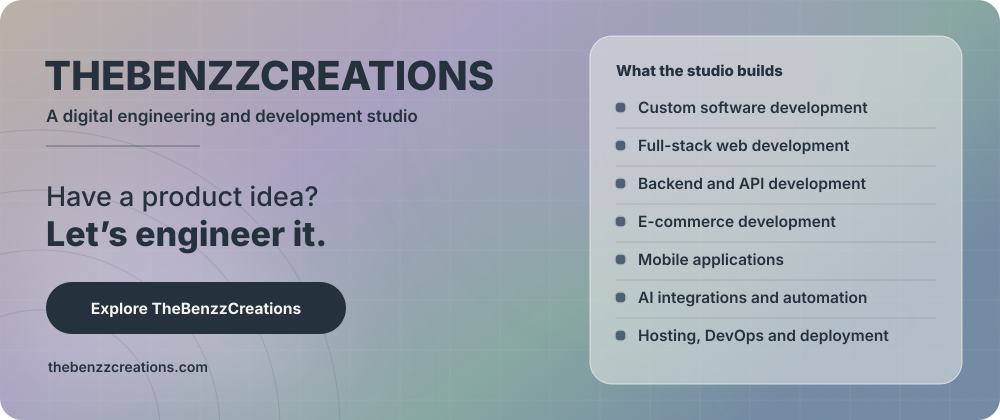</a>

**[Explore TheBenzzCreations](https://thebenzzcreations.com)**

 

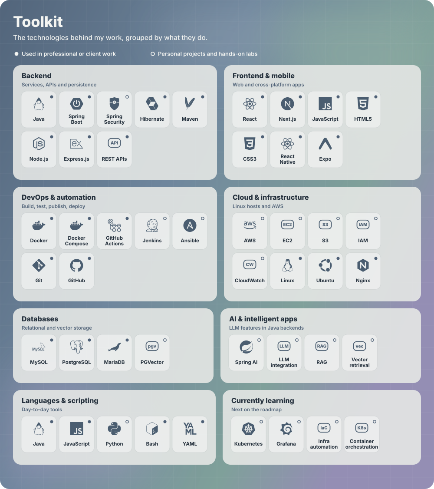

 

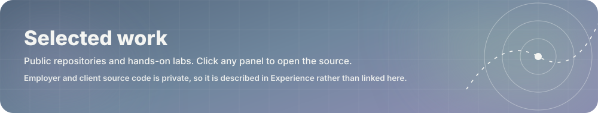

<a href="https://github.com/khushalsehrawat/SentinelAI">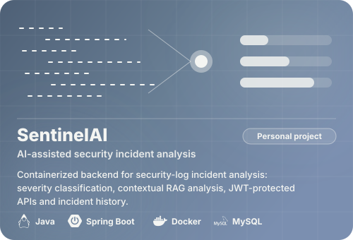</a>
<a href="https://github.com/khushalsehrawat/shrawn">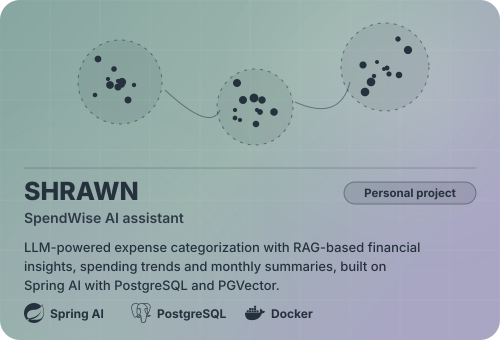</a>
<a href="https://github.com/khushalsehrawat/BeneLoan">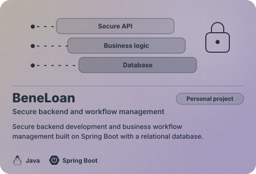</a>
<a href="https://github.com/khushalsehrawat/DuskyHospital">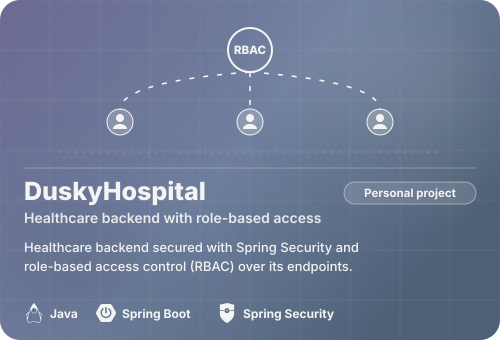</a>
<a href="https://github.com/khushalsehrawat/suems">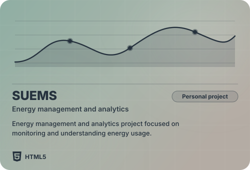</a>
<a href="https://github.com/khushalsehrawat/jenkin-learn">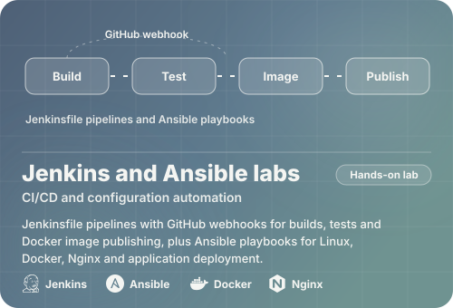</a>
<a href="https://github.com/khushalsehrawat?tab=repositories">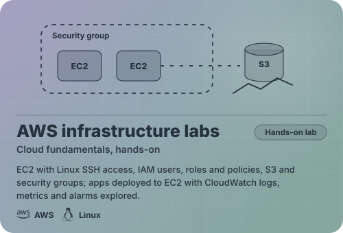</a>
<a href="https://github.com/khushalsehrawat?tab=repositories">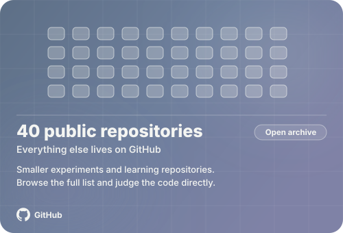</a>

 

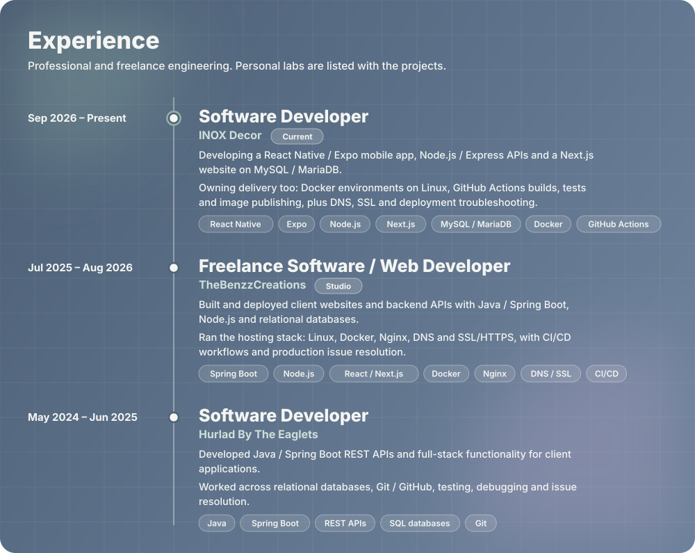

 

<picture>
  <source media="(prefers-color-scheme: dark)" srcset="https://raw.githubusercontent.com/khushalsehrawat/khushalsehrawat/output/snake-dark.svg">
  
</picture>

These charts count public, eligible GitHub activity only. Client and employer work lives in private repositories and does not appear here.

 

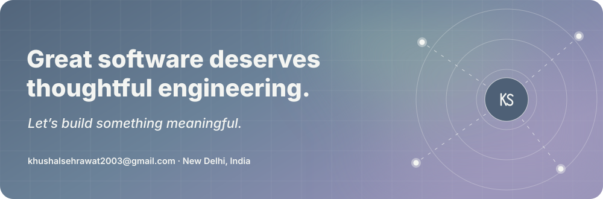

 

B.Tech, Computer Science and Engineering, Maharshi Dayanand University (2026) &nbsp;·&nbsp; Logos: <a href="ATTRIBUTION.md">attribution</a>

