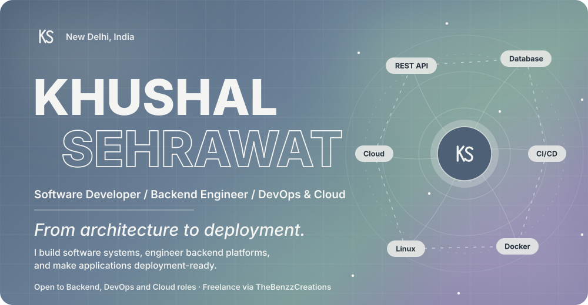

<!-- Khushal Sehrawat · GitHub profile README | Premium editorial / midnight-sage visual system -->

 

**Software Engineering** &nbsp; · &nbsp; **Backend & APIs** &nbsp; · &nbsp; **DevOps / Cloud** &nbsp; · &nbsp; **Web & Mobile**

*I build applications, automate their delivery, and work on the infrastructure that keeps them running.*

---

### 01 / What I bring to the team

<table><tr>
<td width="50%" valign="top">

**BUILD · Application engineering**

- Java / Spring Boot APIs, authentication, persistence and integrations
- Node.js / Express services and database-backed applications
- Next.js websites and React Native / Expo mobile applications
- Real-world debugging across frontend, backend and databases

</td><td width="50%" valign="top">

**SHIP · DevOps & cloud engineering**

- Docker / Compose, Linux servers, GitHub Actions and CI/CD
- Deployments, Nginx, DNS, SSL/TLS and production troubleshooting
- MySQL, PostgreSQL and MariaDB configuration and migrations
- AWS, Jenkins and Ansible through hands-on infrastructure labs

</td></tr></table>

> **My focus:** bridging application development and delivery — from implementing an API to diagnosing a failed build, database connection, or deployment.

### 02 / Selected engineering work

<table>
<tr><td width="50%" valign="top">

**INOX digital platform** · *Professional work*

React Native / Expo app, Node.js / Express APIs, Next.js web platform and MySQL/MariaDB. Worked on authentication, integration, database rollout, GitHub Actions pipelines, container workflows, hosting, DNS and deployment troubleshooting.

`React Native` `Next.js` `Node.js` `Docker` `MariaDB`

</td><td width="50%" valign="top">

**[SentinelAI](https://github.com/khushalsehrawat/SentinelAI)** · *AI-assisted security backend*

Containerized incident-analysis backend with severity classification, contextual RAG analysis, JWT-protected APIs and incident history.

`Java` `Spring Boot` `JWT` `Docker` `MySQL` `RAG`

**[View source →](https://github.com/khushalsehrawat/SentinelAI)**

</td></tr>
<tr><td width="50%" valign="top">

**[SHRAWN · SpendWise AI Assistant](https://github.com/khushalsehrawat/shrawn)** · *AI + finance*

LLM-powered expense categorization and retrieval-augmented financial insights, including spending trends and monthly summaries.

`Spring AI` `Spring Boot` `PGVector` `PostgreSQL` `Docker`

**[View source →](https://github.com/khushalsehrawat/shrawn)**

</td><td width="50%" valign="top">

**Cloud automation & delivery labs** · *Hands-on practice*

Provisioned and explored AWS EC2, IAM, S3, security groups and CloudWatch; built Jenkins pipelines and Ansible playbooks for Linux, Docker, Nginx and application deployments.

`AWS` `Jenkins` `Ansible` `Linux` `CI/CD`

**[Explore Jenkins learning repo →](https://github.com/khushalsehrawat/jenkin-learn)**

</td></tr>
<tr><td width="50%" valign="top">

**[BeneLoan](https://github.com/khushalsehrawat/BeneLoan)** · *Backend engineering*

Loan and beneficiary management API work, including authentication, validation and database design.

`Java` `Spring Boot` `REST APIs` `SQL`

**[View source →](https://github.com/khushalsehrawat/BeneLoan)**

</td><td width="50%" valign="top">

**[DuskyHospital](https://github.com/khushalsehrawat/DuskyHospital)** · *Secure backend*

Healthcare API with role-based access for administrative and clinical workflows.

`Java` `Spring Security` `JWT` `RBAC`

**[View source →](https://github.com/khushalsehrawat/DuskyHospital)**

</td></tr>
</table>

### 03 / The tools behind the work

**Languages & backend**

     

**Cloud, infrastructure & delivery**

      

**Frontend, mobile & data**

     

Currently expanding hands-on experience with Kubernetes (Minikube, kubectl, Pods, Deployments and Services), cloud operations and observability.

### 04 / Experience — engineering across the stack

| Period | Role | Where I contributed |
| :-- | :-- | :-- |
| **Sep 2026 – Present** | **Software Developer · INOX Decor** | Mobile + web platform development; backend integration; Docker, GitHub Actions, database and deployment operations. |
| **Jul 2025 – Aug 2026** | **Freelance Software / Web Developer · TheBenzzCreations** | Delivered client websites and APIs; managed hosting, Linux, domains, SSL, Nginx and ongoing maintenance. |
| **May 2024 – Jun 2025** | **Software Developer · Hurlad By The Eaglets** | Java / Spring Boot services, full-stack functionality, SQL, testing and debugging. |

### 05 / Independent work · TheBenzzCreations

<table><tr><td width="66%" valign="top">

**[TheBenzzCreations](https://www.thebenzzcreations.com)** — my independent software and web development studio.

I work across custom websites, backend services, business applications and deployment workflows, with an emphasis on practical delivery and ongoing support.

**For collaboration:** client web platforms · backend APIs · full-stack development · DevOps support · deployment troubleshooting.

**[Explore the studio →](https://www.thebenzzcreations.com)**

</td><td valign="top" align="center">

*Built for businesses, not just demos.*

</td></tr></table>

### 06 / GitHub activity · work in motion

Live GitHub activity reflects public and eligible contributions; private work and client repositories may not be visible. Activity images depend on third-party services.

### 07 / Let's build something useful

I’m interested in **DevOps / Cloud Engineer**, **Software Developer**, **Java Backend** and **Full-Stack** opportunities — particularly where I can own a feature, automate delivery, and solve production problems.

B.Tech · Computer Science & Engineering · Maharshi Dayanand University, 2026

